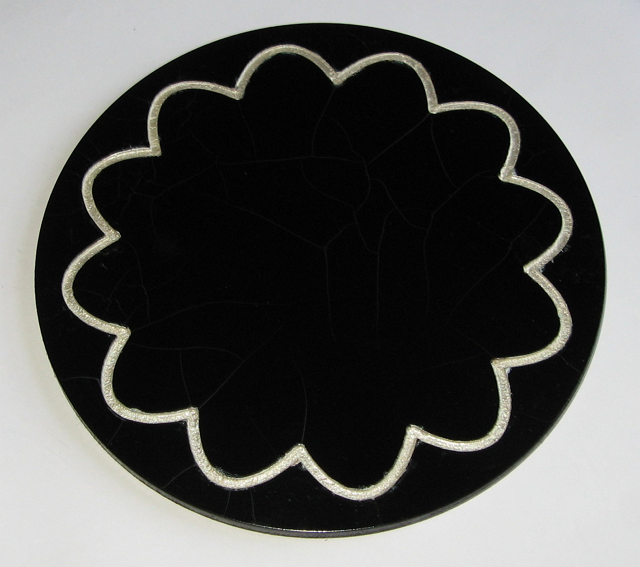

My aim is to cut a pattern through a painted surface, and spray the cuts with a contrasting colour so the pattern stands out from the surface. The question is how best to mask the original painted surface.

I took a piece of mdf , mounted it on a block and trued it on the lathe. Then I sprayed the mdf's surface with several coats of black lacquer to achieve quite a good painted surface.  Then I laid a layer of Frisket film (used by spray artists to mask parts of their work) on that painted surface and cut my test pattern then painted the resultant exposed mdf.

<a href="http://otinexperiences.co.uk/blog/wp-content/uploads/2011/01/IMG_0040.jpg"><em>Image identification provisional — awaiting confirmation.</em></a>You can see that the Frisket film lifted where the cutter changed direction, not much but enough to allow the contrast paint to cover the black.

Frisket film has a low tack value to allow it to be lifted from drawing paper without leaving a mark.  Perhaps too low a tack in this case but I did lift the film once when altering its position so may be that caused a problem. However I was pleased enough with the results so I shall continue and try another couple of tests but also look for an alternative masking agent.
