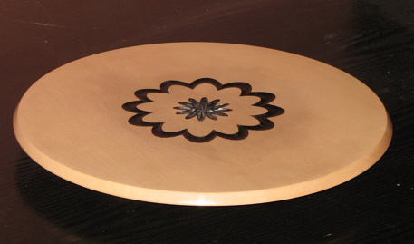

Today I completed finishing my first piece of work using my cutting frame. It is a cake stand roughly 14 inches in diameter(360mm) and stands just over a1 inch (30mm) high. The wood is sycamore. The piece was turned and completely sealed and sprayed with a couple of coats of varnish before I cut the pattern. After the simple pattern was cut I painted it with black paint and when dry sprayed on three more coats of acrylic lacquer. Finally I waxed the piece and buffed it on my buffing wheel.

