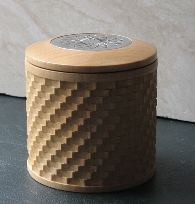

I have used two of the gcode programs to create this small box. The side was cut using a modified version of the index program and the pewter insert was cut using a modified version of the badge program.

