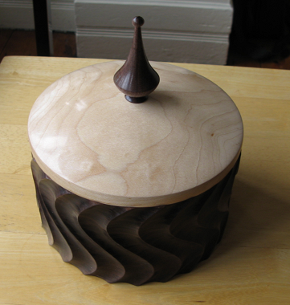
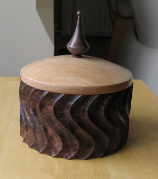

I have just finished a box 130mm diameter, with a wave pattern cut on its side. The wood of the box is walnut, the lid is maple and the finial is again walnut.

There is a problem in that I came across a split in the walnut as I was cutting the pattern but decided to continue anyway. Also the grain is quite wild so there is a lot of tearout along a few of the cuts. How do you avoid that? I thought my cutter was quite sharp and the feed rate was slow and I was only taking 0.5 mm depth per cut.

 
