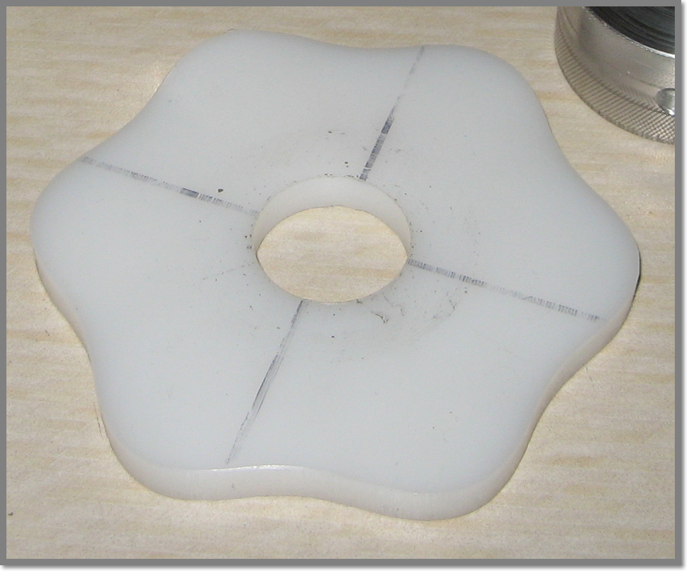

The last couple of days I have been looking at cutting rosettes for my machine.

The last couple of days I have been looking at cutting rosettes for my machine.

*My first rosette, a 150mm diameter wave with 6 nodes and an amplitude of 5mm.*

[This page](/cutting-a-rosette/) shows how I created the rosette above. Next step is to create the rubbers so that the outline of the rosette is translated into a headstock movement on my machine.
