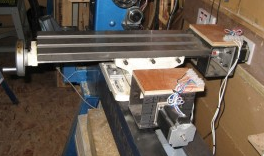

<h3>History</h3>
I first started by using a simple stepper motor based CNC system. I mounted a stepper motor connected to a gearbox onto my wood turning lathe to control the lathe spindle.  The motor connects to the spindle using a timing belt. I removed the timing belt when I wanted to do some plain wood turning  and added it when I wanted to precisely control the position and slow movement of the spindle for ornamental turning.

<dl id="attachment_6"> <dt></dt> <dd>View of stepper motor mounted on my lathe headstock</dd> </dl>

I also added a cheap XY table to the lathe bed also controlled by stepper motors. On which I have mounted bracket capable of holding either a a <a href="http://www.proxxon-direct.com/acatalog/Mill_Drill_system_BFW_40_E_with_controller.html" target="_blank">proxxon</a> BFW40 milling motor, a simple probe and a simple OT cutting frame.

<dl id="attachment_10"> <dt></dt> <dd>XY table mounted on lathe</dd> </dl>

<dl id="attachment_12"> <dt></dt> <dd>View of XY table with milling head</dd> </dl>

The image above also shows my Cole jaws attached to my chuck. I milled a perspex sheet to fit over the jaws and present a smooth surface on which I can attach paper. I can run the machine using a pencil instead of a cutter to see if the pattern is turning out as I intended.

I am using some free Linux based software called <a href="http://wiki.linuxcnc.org/cgi-bin/emcinfo.pl?EmcKnowledgeBase" target="_blank" title="Emc2">emc</a> to control the motors.

I hope to use this setup to cut patterns on the surface of turned wooden pieces. To help with this I am developing some software which I call Ornamental Turning Workbench which will allow me to design patterns and then generate the gcode that instructs emc where to move.

This first version was really unsatisfactory, the XY table just wasn't accurate enough and besides I had grander plans. So after seeing the <a href="http://www.ornamentalroseengine.com/rre/index.htm">Rambling Rose engine </a>by Fred Connell &amp; Roland Hege I decided to make my own out of Aluminum. This of course meant that I had to start by buying a metal lathe and a milling machine.  Thus started Rose2 project around September 2009 so now 7-8 months later I have almost completed my Rose mark 2.  All I have left to do is connect up the home and limit switches but I do not need them to cut patterns so long as I am careful not to let the machine plow through the limit of its travel in any axis. So to all intents the images above are purely just a historical record.
