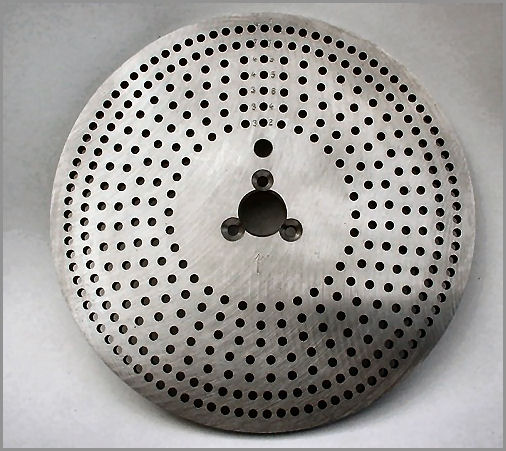

Many patterns in OT work are made by repeating simple operations over and over again at different positions around the work.
 
 200 mm diameter mahogany box
 
In the box above the castellated top was created using indexing as was the pattern around the base

## Manual method

Traditionally this is achieved by using an index plate which is a plate having many holes around its periphery (the standard was to have 96 holes ).
An indexing pin fitted into one of the holes and held the work at a certain position. The number of repetitions required determined  which holes would be used to pin the work.  For example if 6 repetitions where required and a 96 hole plate was used then you would need to pin the work at every 16th hole because 96/6 = 16.
Indeed 96 was originally chosen because that number has many divisors thus allowing many repetitions.  But there are other numbers of repetitions that cannot be obtained using 96 holes (5 for example). So many other rings of holes are required.

### CNC approach

Basically this is to simulate an index plate in software to rotate the work through to the required angle. For example 6 repetitions would require the work to be rotated by 60 degrees (360 / 6) for each move to the next index  position.
Once at the required position the code to cut the pattern would be executed.  One way of achieving this in linuxcnc is to use a loop which calls a subroutine to perform the work required at each index position. See [here](http://ab48.uk/otblog/software/g-code-examples/indexing/)
