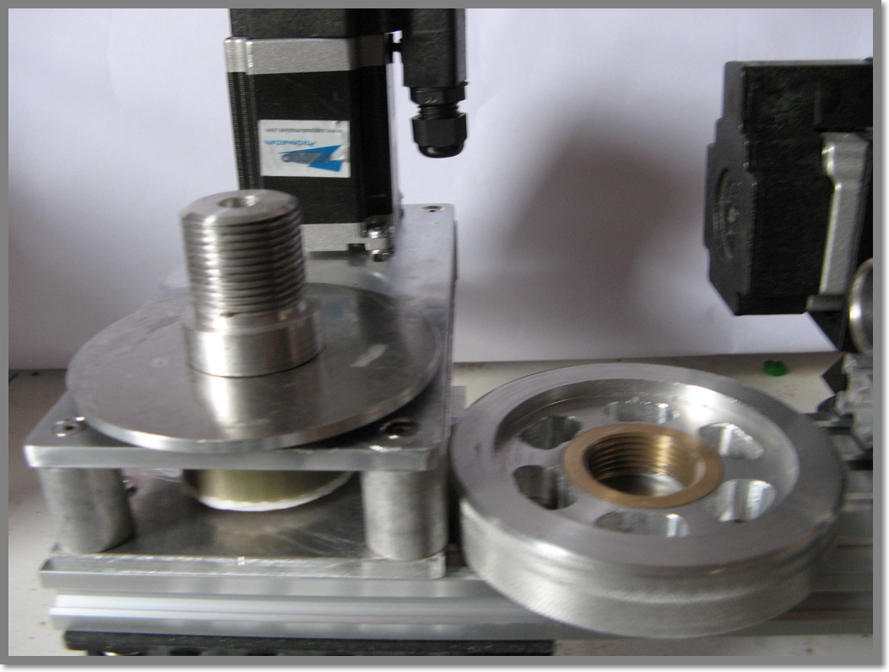
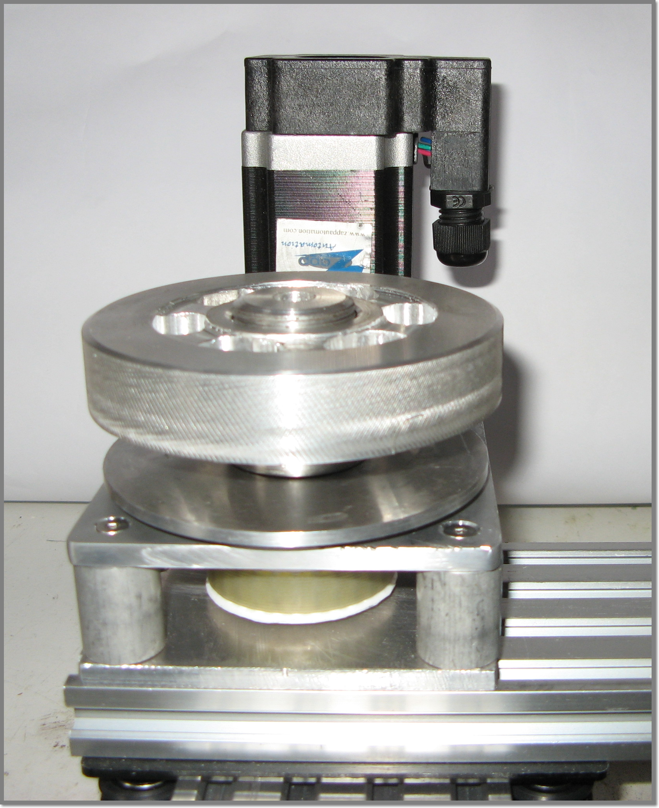
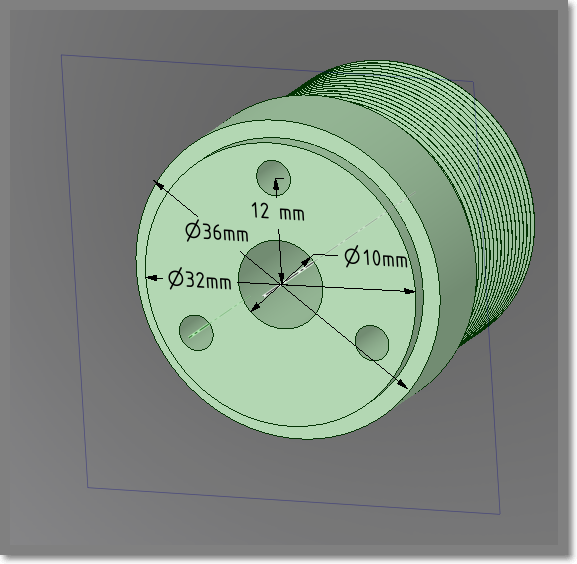
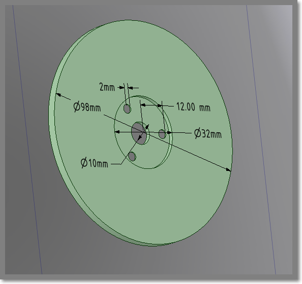
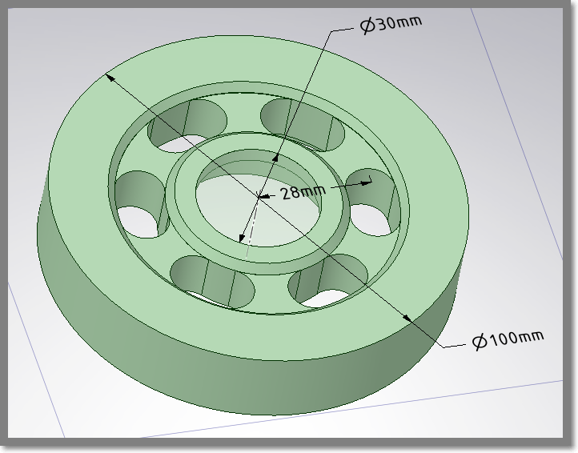
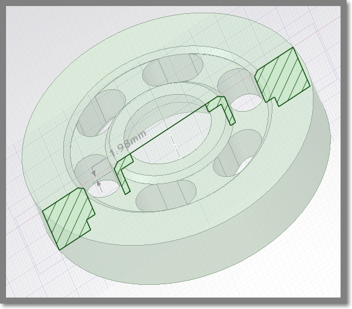
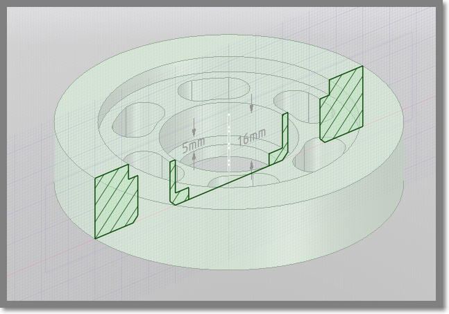
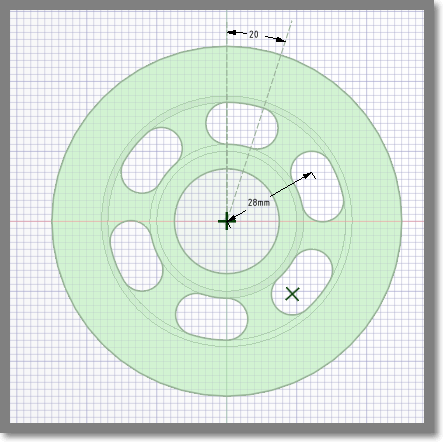

I have created version 1 of the rosette carrier for my new machine.

I decided to make all the parts out of aluminium as I thought that the printed plastic parts would  not be robust enough.
The carrier is made from a 100 mm diameter x 4 mm thick disc  which is attached to a shaft having a 36 mm diameter collar topped by a 30 mm diameter by 2 mm pitch threaded section.  The  bottom of this shaft has a tenon 16 mm diameter which fits snugly into a similar sized rebate in the disc (the size of my largest end mill). Three m4 countersunk headed screws placed equally around the shaft attach disc and shaft together.  Once connected together both parts were  held in the lathe using the collar and then drilled with in 9.6 mm drill which was reamed to give a final 10 mm diameter central  hole through the both concentric with the collar.
The carrier is held on its 10 mm diameter shaft by a M6 set-screw passing through the middle of the collar (not shown in the image above).
Rosettes  will have a central 36 mm diameter hole machined to be a close fit to the collar and then held in place by compression using a heavier top that is screwed down the M30 x 2mm threaded part of the shaft.
The underside of this top is shown in the image above.  It is  made from a 100mm diameter and 20 mm thick  piece of rod.  I decided to make a 40 mm diameter threaded brass insert for the top  which is set into the aluminium and held by epoxy.  There is also a 4 mm deep recess machined into the top to allow the gap between the top and bottom plates to be slightly less than 10 mm when the top is fully screwed onto the shaft.  The top has 6 slots machined through it to make it lighter than a solid piece and is also knurled around its outside edge for grip.

## Drawings

 

 

