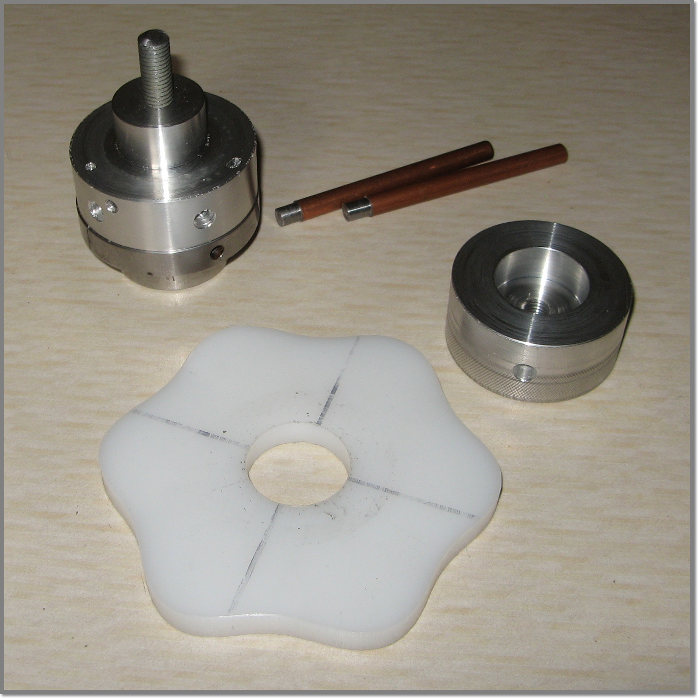
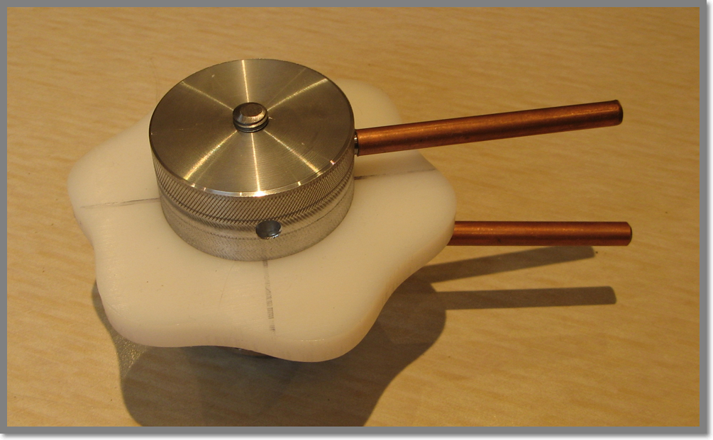
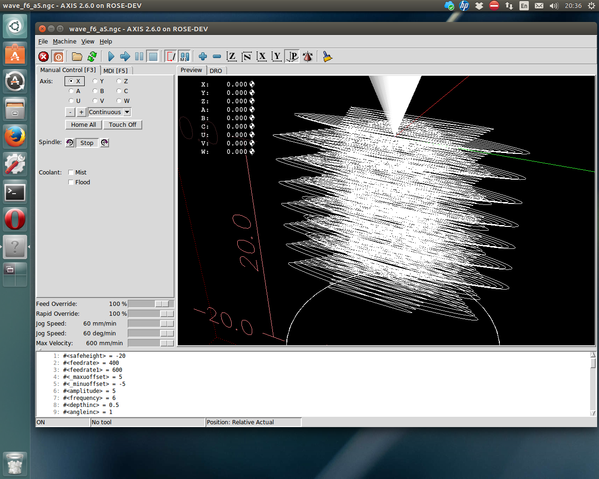
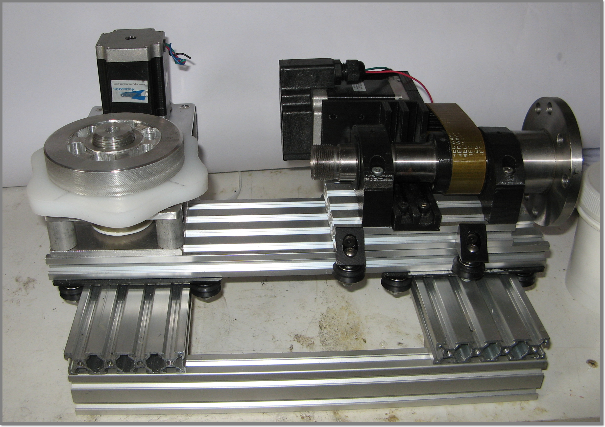
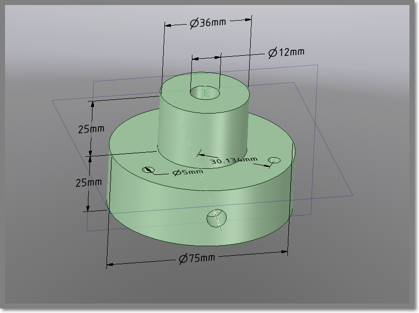
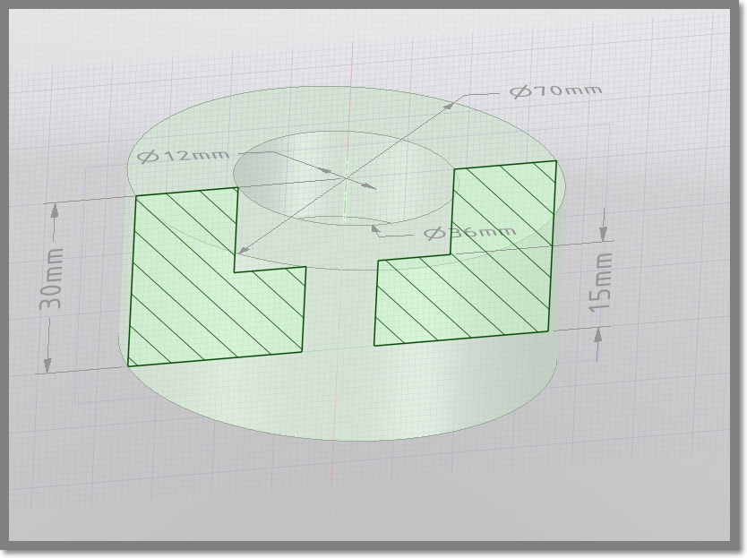

## Equipment

Now my rosette carrier is complete (except for wiring up the motor) I needed to make at least one rosette in order to try it out. I am going to use my current machine to cut the rosettes for this new manual machine. In order to do this I needed a method of mounting  a rosette blank onto my machine for cutting.
Using  a small faceplate I had purchased from [Axminster tools](http://www.axminster.co.uk/axminster-faceplate-50mm) as a base.  Onto this I mounted an aluminium mandrel which had a stub machined to 36 mm diameter (to match the diameter of my rosette holder).
I decided to hold the rosette blank by screwing a top down onto it.  So  made the length of the 36 mm diameter stub  twice the thickness of a rosette blank . I then made a cap  that  had a matching bore of 36mm diameter so that there was a sliding fit between mandrel stub and cap.  Rather than machine cut a screw thread on both parts I decided to use threaded rod,  so I  tapped an M12 thread in both stub and cap so that I could screw a small piece of M12 allthread rod into the mandrel stub and then screw the cap down onto that.

 
Although I had knurled the cap I decided I needed to put a little more force when tightening the cap against a rosette blank. Using my rotary table I drilled 4 M8 holes around both mandrel and cap in order to use two small bars to ensure that the cap was tightly screwed down onto the rosette blank.

 
Now I had my holder I needed to test everything out. I have a 12 mm thick  piece of white HDPE in my scrap box so I cut a 150 mm square blank from that to use as a test piece.

## Cutting a Rosette blank

I decided to cut a wave with 6 lobes and an amplitude of 5mm as my test as a wave is easily programmed in g-code.  Because a rosette requires that the pattern be cut around the side of a blank one cannot start by cutting the full pattern into the blank in one pass.
Take  my test rosette as an example, the  depth difference between the highest and lowest points on a wave rosette is twice its amplitude, which is 10 mm in this case. This is far to great a depth to cut in one pass. What you need to do is make several passes around the blank moving the cutting tool in towards the  centre at the beginning of each pass. Cutting 0.5 mm deep at each pass requires 20 complete passes to cut the profile in this case.  Assuming an 0.5 mm cut the first pass is actually started at 9.5 mm away from the surface of the blank and this will only cut the 6 lobe tops on the first pass. As you progress by moving the cutter towards the centre in 0.5 mm increments you will cut more and more of the pattern. To cut the last pass the tool will be starting at the original surface of the blank and this pass will finally cut the 6 lowest points between the lobes.

## Software

One of the benefits of having movement along two parallel axes (X and U in my case ) is that you can separate out the two movements of 1) cutting the profile and 2) moving the cutter towards the work and assign each to its own axis.  So I allocate the lateral headstock axis (X) for movements that cut the profile and the tool-positioner axis (U) to move the cutting tool towards the blank.  This makes the gcode simpler to write.  Thus the  program I wrote  [wave\_f6\_a5](http://ab48.uk/otblog/wp-content/uploads/2014/09/wave_f6_a5.txt)  uses this technique. If you only have one axis for tool moves you must do a subtraction to get the correct position.
The rosette was cut using a round edged cutter and the emc plot for the cutter path is shown below. The plot is rather cluttered and unhelpful.  The layers  at least show the path for Z positions as we move the cutter across the blank.

Finally here is the freshly cut rosette mounted on the modular rose engine.

## Drawings

Remember that the 12mm holes in the drawings below are actually threaded M12 as the thread is not shown.
 Carrier base for cutting rosette. Sits on M33x3.5 threaded faceplate
 Screw on cap for holding rosette on base
