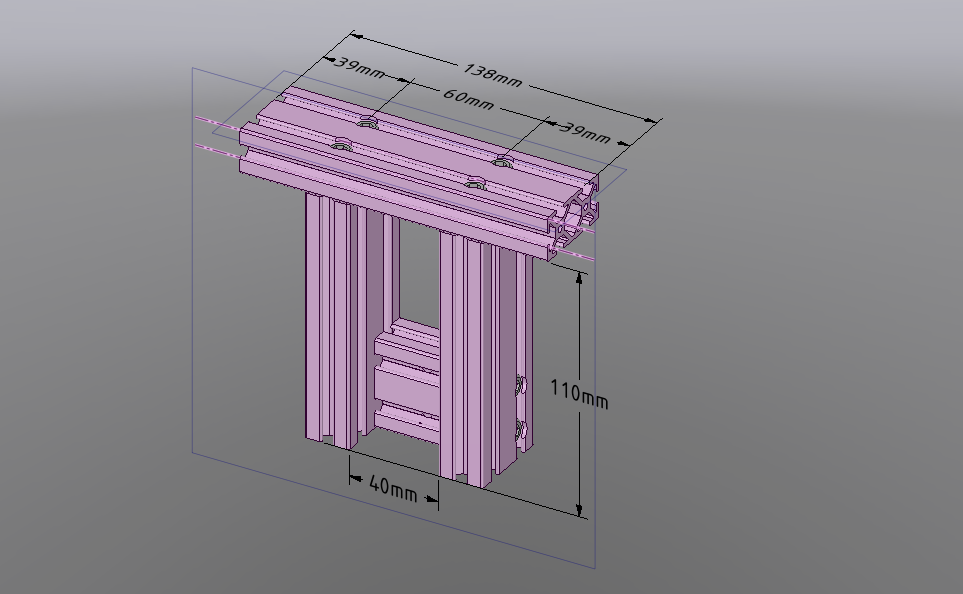
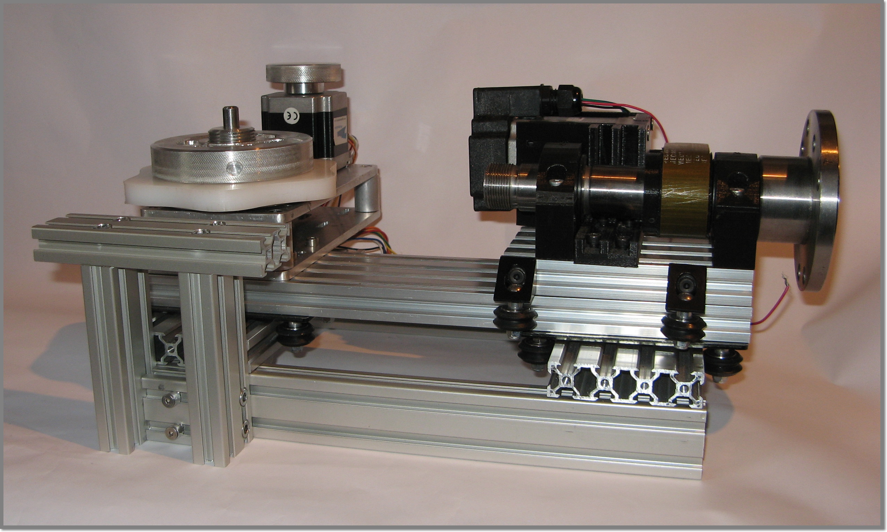

The post to which the rubber is attached is made from several small pieces of 40x20 standard aluminium section bolted together using m6 bolts which screw into tapped holes in the section.  The width of the post is 80mm overall to match that of the section being used. The height of the  rubber post is set so that its top surface is about 2mm below the level of the bottom of a rosette.  Again sizes are adjustable to suit individual designs.

The post is attached directly to the side of the headstock frame using standard drop in nuts.

