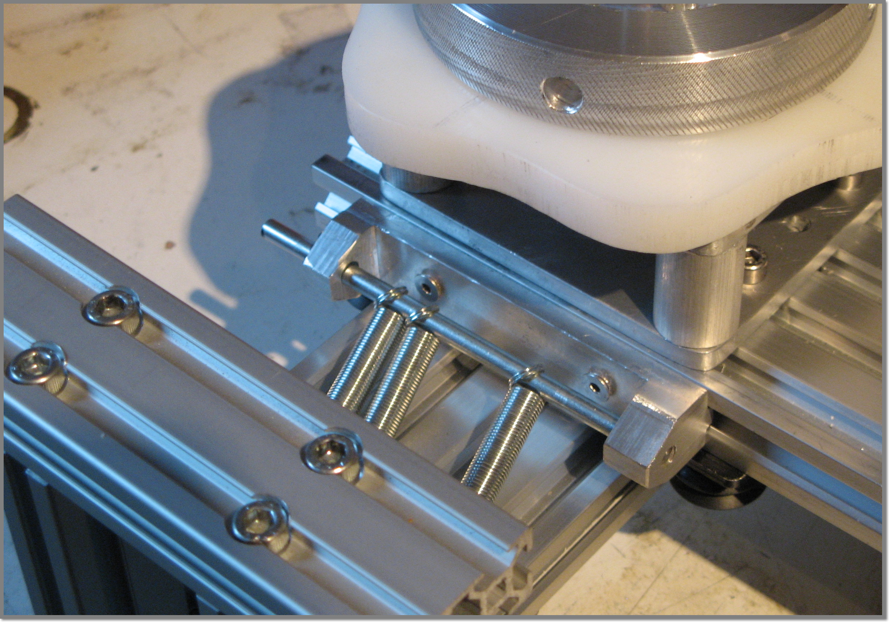
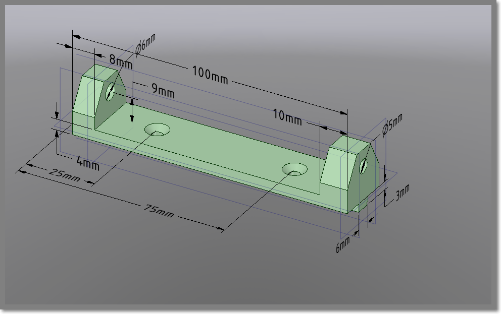
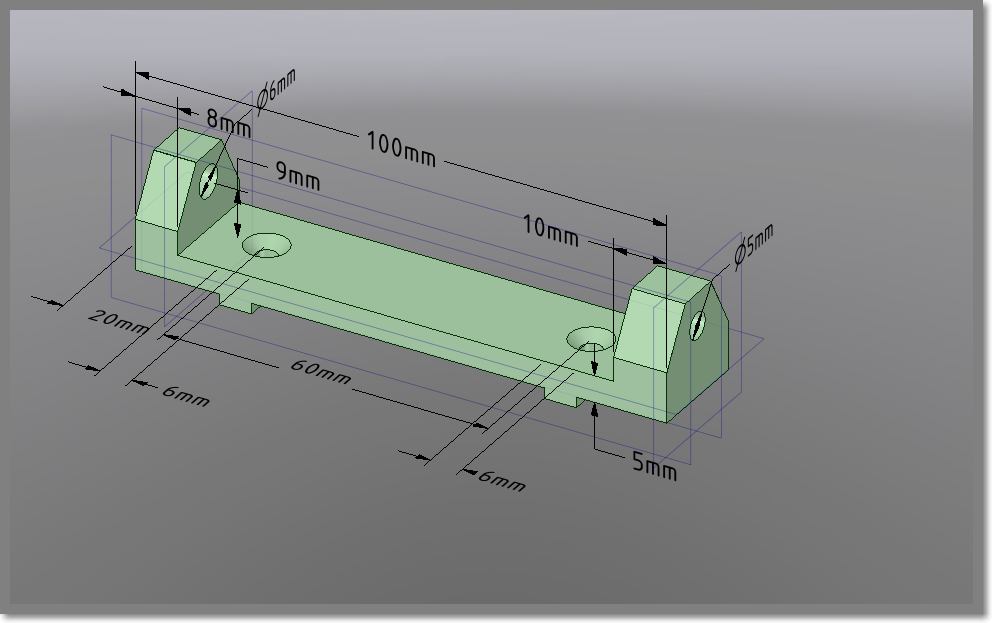

We need some type of spring arrangement to pull the movable headstock  so that the rosette is firmly against the rubber. Otherwise the shape of the rubber will not be followed exactly. (This sometimes is useful).
There are many types of arrangements used from just using a weight attached to a string through to leaf spring type arrangements and can include complex damping mechanisms.
I am starting with a simple tension spring mechanism with no damping.  This is a simple arrangement comprising of two brackets connected by one or more tension springs. One bracket is connected to a stationary point somewhere on the machine, whilst the other is connected to the moveable headstock.  As the rotation of the rosette against  the fixed rubber forces the headstock away from its resting point the tension spring(s) expand and the  force generated pulls the two brackets back together again.
I envisage that on my machine these two brackets will be in line with the rubber holder. This is shown in the image below.

The first bracket is attached as shown to the side of the headstock slide. The second bracket will be connected to the rubber holder.

## Drawings

 Bracket connecting to side of headstock. It rides in the slot and uses drop in nuts to fix it two the aluminium section
The bracket attaching to the rubber post will be similar except it has to fit in the two vertical slots of the tool post. If the second bracket were just to fit on the side of the machine you it would be a copy of the first one given above.
 Base modified so that it connects in the vertical slots of the rubber post.
In all cases the  holes in the thickest end of the brackets are threaded m6.  Springs are held on a 6mm diameter axle that screws into the threaded end of the bracket.
