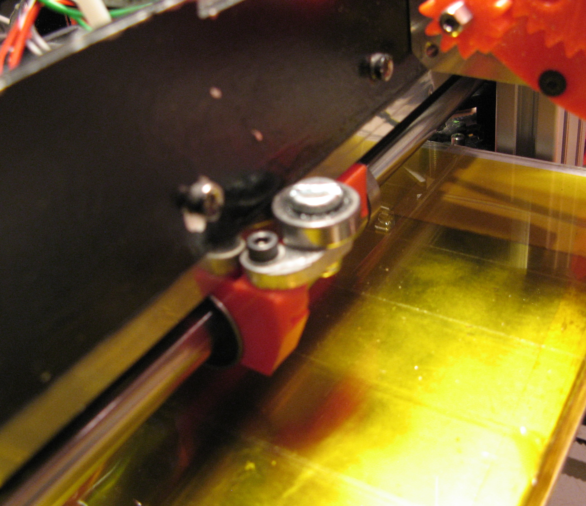
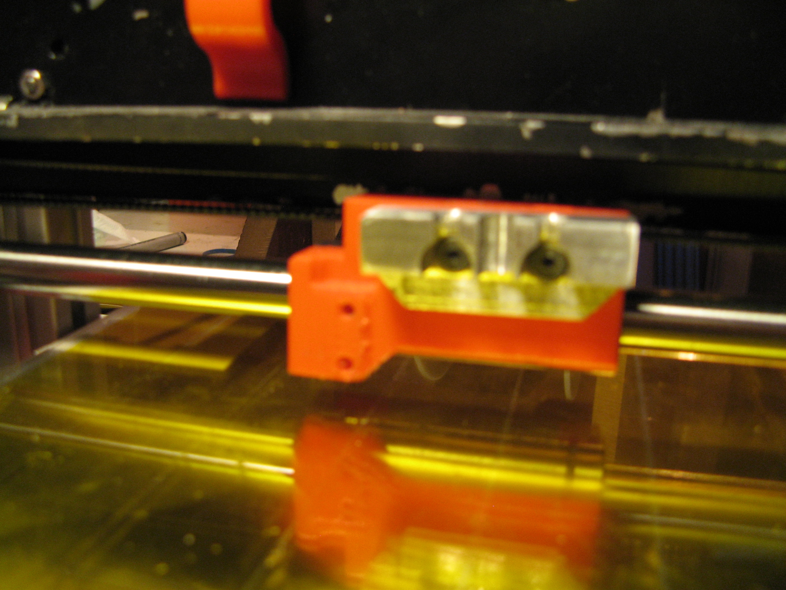
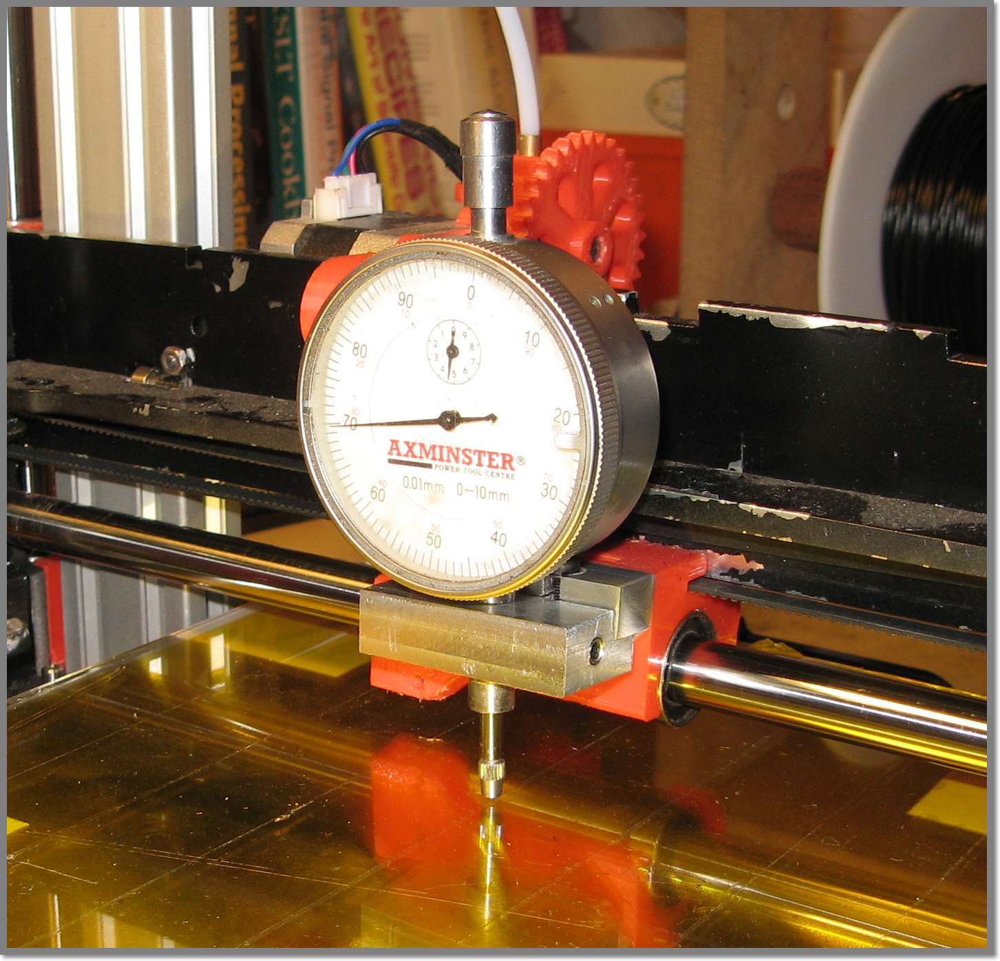

I have made the  mods listed below.

1. Replaced the mdf bed with an aluminium one supplied by DaveK0974 in the [Ormerod forum](http://forums.reprap.org/list.php?340). This is spring loaded at three points to make it easy to level.
2. Replaced the acrylic X axis with an aluminium one also supplied by DaveK0974 (see above). I sprayed the arm with black acrylic, that was a mistake as it keeps chipping off.
3. Replaced the Z axis sensor with the infra red sensor  produced by dc42 see the Ormerod forum again for information.
4. Replaced the bearing running along the Y axis with an adjustable one of 10mm diameter.
5. Replaced the plastic part that connects the hot head to the Y carriage with an aluminium one.
6. Added a support to allow me to attach a dial gauge used to level the bed. 
